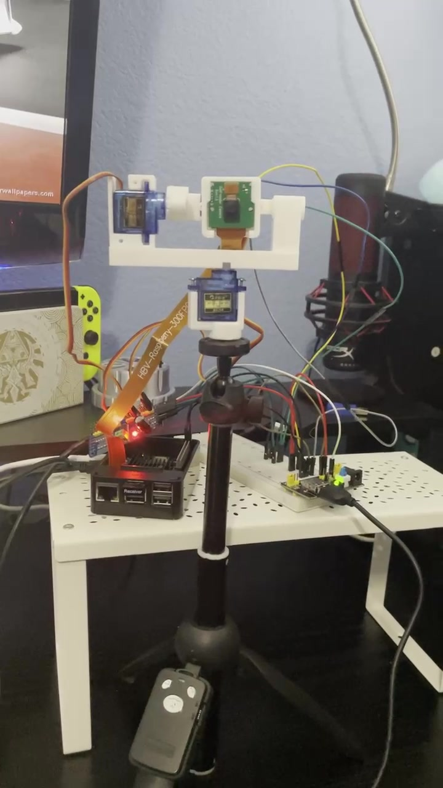
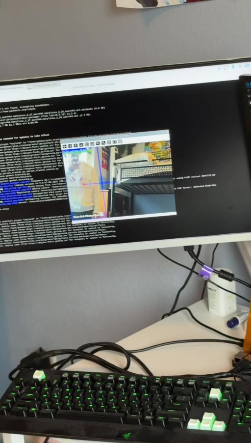

# YOLO Camera Tracking Gimbal

A Raspberry Pi camera gimbal that uses YOLO person detection and ByteTrack to track a person in the camera image. The prototype combines the camera software with a three-axis servo mount and orientation feedback.

**Project team: Yousef Ahmadzai and Timothy Titus.**

I handled the camera module setup and wrote all the project code, including the person tracking, servo control, and IMU integration. Timothy handled the chassis printing, servo calibration, and IMU hardware setup.

## Demos


https://github.com/user-attachments/assets/777e8838-c9c0-4bbc-82a6-2825a546ff8e


| Assembled gimbal | My person tracking tests |
| :---: | :---: |
| [](media/videos/complete-gimbal-demo.mp4) | [](media/videos/person-tracking-test-02.mp4) |
| [Watch the assembled gimbal demo](media/videos/complete-gimbal-demo.mp4) | [Watch the tracking test](media/videos/person-tracking-test-02.mp4) |

The recordings show different stages of the project, including camera tracking, an IMU and servo test, and the assembled gimbal.

## Team and contributions

| Contributor | Work on the project |
| --- | --- |
| **Yousef Ahmadzai** | Camera module setup and configuration; all project code, including camera capture, YOLO and ByteTrack person tracking, target selection, image offset calculations, servo control, IMU integration, and calibration routines; software tuning, tweaking, and testing |
| **Timothy Titus** | 3D printing the chassis and gimbal structure, servo calibration, and IMU hardware setup |

I wrote the software that connects the camera tracking to the servo commands and IMU readings. I also adjusted the tracking settings and tested how the system behaves when a person moves or leaves the camera view. Timothy handled the chassis printing and hardware calibration and setup listed above.

I contributed a research section about how LiDAR measurements are captured and used in robot navigation. The research documents are in `docs`. This camera project uses image-based tracking and does not measure distance with LiDAR.

The videos and hardware photos show the prototype Timothy and I worked on together.

## How the software works

1. Picamera2 captures a 640 × 480 camera frame.
2. YOLO detects people, and ByteTrack assigns tracking IDs.
3. The software keeps the selected ID while it is available. If that ID disappears, it can select another available tracked person.
4. The center of the person's bounding box is compared with the center of the camera image.
5. Errors larger than 25 pixels adjust the yaw and pitch targets. Each servo command is limited to a maximum change of 2 degrees per update.
6. The integration script also reads accelerometer and gyroscope data from an MPU-9250 interface and uses the roll estimate for roll leveling.

When no target is detected, the script keeps the last yaw and pitch targets. It does not keep a missing person's identity across a prolonged loss of detection.

## Videos and photos

| File | What it shows | Length |
| --- | --- | --- |
| [Assembled gimbal demo](media/videos/complete-gimbal-demo.mp4) | Our prototype, camera mount, and operating setup | 2 min 9 sec |
| [IMU and servo test](media/videos/imu-servo-test.mp4) | A handheld orientation sensor and the servo test setup | 45 sec |
| [Person tracking test 1](media/videos/person-tracking-test-01.mp4) | Person detection, a target ID, and the tracking display | 8 sec |
| [Person tracking test 2](media/videos/person-tracking-test-02.mp4) | Person tracking and the target leaving and returning to view | 17 sec |
| [Gimbal with camera](media/images/gimbal-with-camera.jpg) | Camera mounted in the servo frame | Photo |
| [Gimbal frame](media/images/gimbal-frame.jpg) | The printed frame and three micro servos | Photo |

## Hardware and software

The project uses a Raspberry Pi 5, a camera connected over CSI, a printed gimbal frame, and three micro servos. The included Python script uses an MPU-9250 interface over I²C for orientation feedback.

| Software | Purpose |
| --- | --- |
| Python | Camera capture and control loop |
| Picamera2 | Raspberry Pi camera access |
| Ultralytics YOLO | Person detection |
| ByteTrack | Tracking IDs between frames |
| OpenCV | Drawing the target, offsets, and status display |
| lgpio | GPIO servo commands |
| smbus | Reading the IMU over I²C |

## Source code

The Python software in [src/gimbal_tracking.py](src/gimbal_tracking.py) handles camera capture, person tracking, servo control, and IMU feedback.

| Key | Action |
| --- | --- |
| `t` | Enable person tracking |
| `b` | Enable roll balancing while retaining the yaw and pitch position |
| `c` | Center the servos, recalibrate the IMU, and resume tracking |
| `q` | Quit and release the hardware |

The script starts in tracking mode. See [software notes](docs/software-notes.md) for its configuration and behavior.

## Running on a Raspberry Pi

The script needs the camera, three servo outputs, and an IMU to be available at startup. It also needs a desktop display for the OpenCV window. Review the GPIO assignments, servo limits, and IMU address in the software notes against the actual build before running.

A starting environment on Raspberry Pi OS is:

```bash
sudo apt update
sudo apt install python3-venv python3-picamera2 python3-opencv \
    python3-lgpio python3-smbus
python3 -m venv --system-site-packages .venv
source .venv/bin/activate
python -m pip install -r requirements.txt
```

Enable the Pi's I²C interface. Place compatible model weights named `yolo26n.pt` in the repository root, or change `MODEL_PATH` in the script to match the weights being used. Model weights are not included.

Run from the repository root:

```bash
python src/gimbal_tracking.py
```

Exact dependency versions from the original Pi setup are not pinned, and the code revision used for each recording is not documented. The videos show the prototype at different stages of development. Reproducing the hardware setup requires checking the GPIO assignments, servo directions, and IMU mounting against the build.

Setup references: [Picamera2 documentation](https://www.raspberrypi.com/documentation/accessories/camera-software.html), [Picamera2 manual](https://datasheets.raspberrypi.com/camera/picamera2-manual.pdf), and [Ultralytics on Raspberry Pi](https://docs.ultralytics.com/guides/raspberry-pi/).

## Research documents

| Document | Credit and scope |
| --- | --- |
| [LiDAR software and navigation research](docs/lidar-software-research-yousef.docx) | My research section about LiDAR data and the MiR250 example |
| [LiDAR in Robotics presentation](docs/lidar-in-robotics-draft.pptx) | Research presentation with project credits for Yousef Ahmadzai and Timothy Titus |

The research section and presentation provide background for the project's sensor research.
